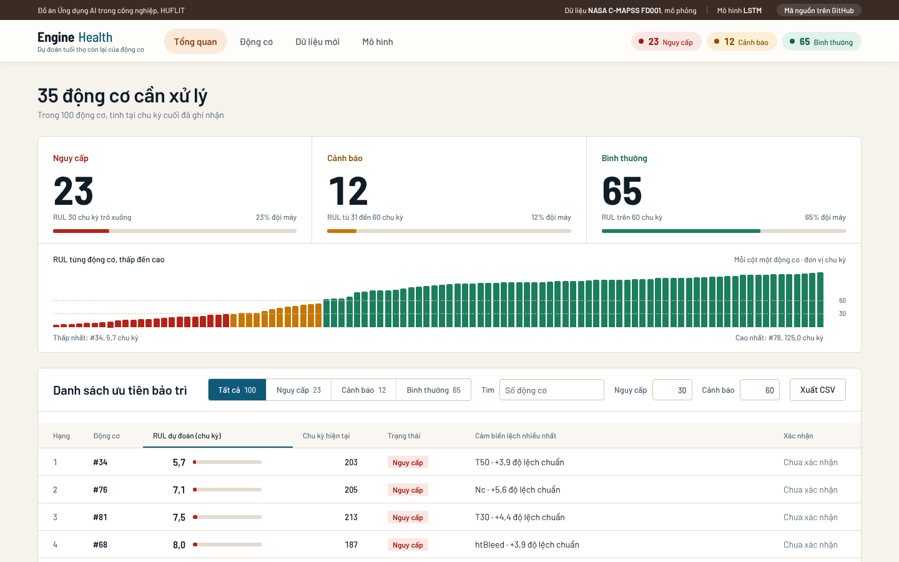
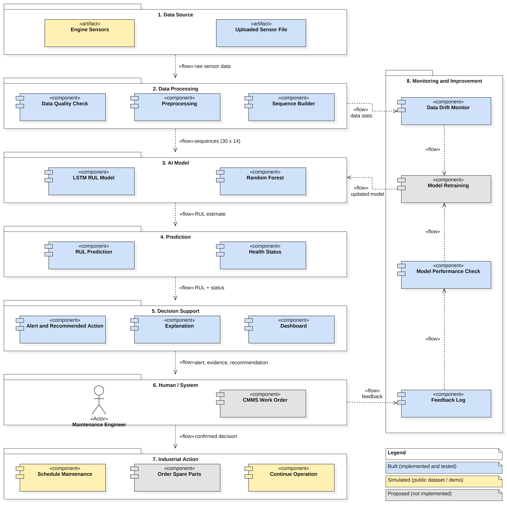
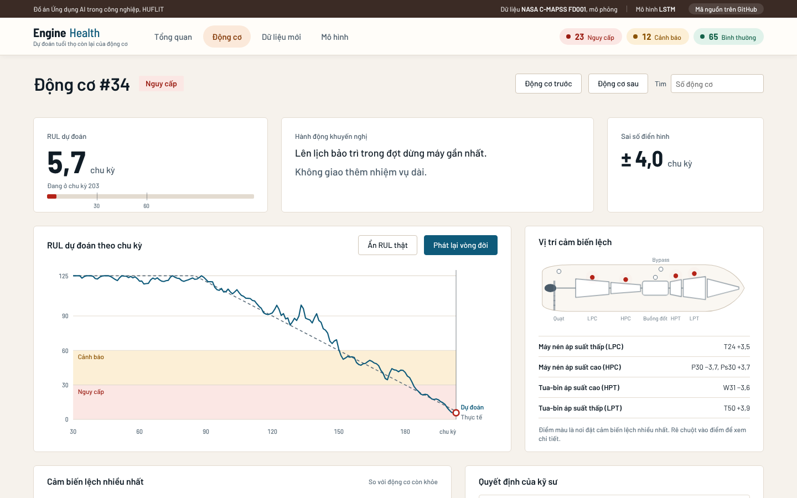
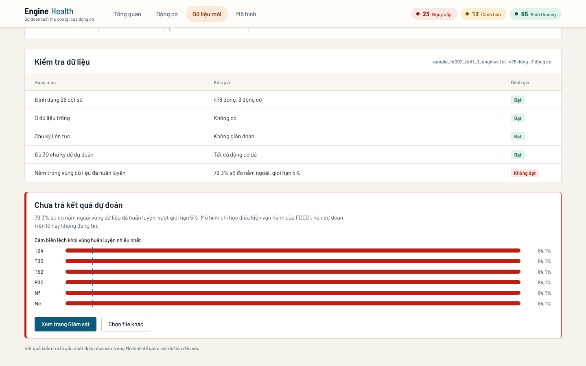
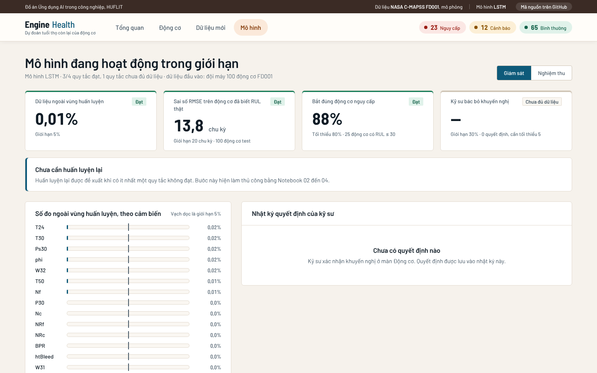

# Turbofan Engine RUL Prediction

Predicting the Remaining Useful Life (RUL) of turbofan engines from sensor data, and turning the prediction into a maintenance decision. Built on the NASA C-MAPSS FD001 benchmark as an end-to-end Industrial AI solution: problem definition, data analysis, three compared methods, three-level evaluation, a decision-support web app, and post-deployment monitoring.




## Results at a glance

Final evaluation on the 100 NASA test engines (RUL capped at 125 cycles, the usual convention for C-MAPSS):

| Model | RMSE | MAE | NASA score | Alert recall | False alarms | Latency (CPU) | RMSE with 5% sensor noise |
|---|---|---|---|---|---|---|---|
| Linear Regression | 17.49 | 14.07 | 626 | 48% | 0.0% | < 1 ms | 22.9 |
| Random Forest | 16.93 | 12.40 | 762 | 72% | 1.3% | 26 ms | 33.2 |
| **LSTM** | **13.84** | 10.07 | 374 | 88% | 1.3% | 52 ms | 15.6 |

- **LSTM is the only model that meets every acceptance criterion** defined before evaluation, so it is the deployed model. Random Forest is kept as a fallback.
- The alert "RUL ≤ 30 cycles" catches 22 of 25 engines that really need maintenance, with 1 false alarm.
- None of the three models transfers to other operating conditions (RMSE > 55 on FD002). The web app therefore checks every uploaded file for out-of-range sensor values and withholds predictions when more than 5% of readings fall outside the training range.

Maintenance policy simulation on 20 held-out run-to-failure engines (cost units are illustrative assumptions: planned = 1, unplanned failure = 5):

| Policy | Unplanned failures | Engine life used | Cost per 1,000 cycles |
|---|---|---|---|
| Reactive | 20 | 100% | 24.6 |
| Preventive (T=128) | 0 | 63% | 7.8 |
| Predictive - LSTM | 0 | 86% | 5.7 |

Robustness checks (notebook 04):

- **Retraining stability:** LSTM retrained with 5 other seeds gives test RMSE 13.66 ± 0.29 and alert recall 80–96%; every run still meets the acceptance criteria.
- **Cost sensitivity:** across preventive intervals of 128–180 cycles and failure/planned cost ratios of 3–10, the cheapest preventive setting (7.37) is still about 22% more expensive than predictive maintenance with LSTM (5.74).
- **Explainability:** permutation importance shows the LSTM uses all 14 sensors, led by Ps30 (HPC static pressure), consistent with the FD001 fault mode. Alert ROC-AUC is 0.995 (LSTM), 0.988 (Random Forest), 0.992 (Linear Regression).

All figures are reproduced by the notebooks and stored in [`reports/metrics.json`](reports/metrics.json).

## Industrial AI lifecycle

The project follows the eight-step Industrial AI development lifecycle. Each step maps to one place in the repository:

| Step | What was done | Where |
|---|---|---|
| 1. Problem Definition | Operational problem, users, decision, constraints, acceptance criteria | [`notebooks/01`](notebooks/01_problem_and_data_understanding.ipynb) |
| 2. Data Understanding | Structure, statistics, degradation trends, 3B analysis (Broken, Bad quality, Background) | [`notebooks/01`](notebooks/01_problem_and_data_understanding.ipynb) |
| 3. Data Preparation | RUL labelling, engine-wise split, scaling, rolling features, with the reason for each step | [`notebooks/02`](notebooks/02_data_preparation.ipynb) |
| 4. Method Selection | Baseline regression vs. Random Forest vs. LSTM, chosen from problem, data and constraints | [`notebooks/03`](notebooks/03_method_selection_and_modeling.ipynb) |
| 5. Model Development | Training, validation-based tuning, early stopping | [`notebooks/03`](notebooks/03_method_selection_and_modeling.ipynb) |
| 6. Evaluation | Model level, system level, industrial level, acceptance decision | [`notebooks/04`](notebooks/04_evaluation.ipynb) |
| 7. Deployment | Local web app: Data → AI → Decision, with human confirmation | [`app/`](app/) (FastAPI server + HTML/JS) |
| 8. Monitoring and Improvement | Data-drift check, performance check, engineer feedback log, retraining trigger | [`app/`](app/) (Model page) |

## Architecture



## Web app

| Engine detail: status, evidence, recommended action | Out-of-distribution upload is blocked |
|---|---|
|  |  |



Four pages: **Overview** ranks the fleet by urgency; **Engine** shows the RUL trend, the deviating sensors on an engine schematic, the recommended action, and records the maintenance engineer's decision; **New data** checks an uploaded sensor file before predicting; **Model** monitors four rules (input drift, RMSE, alert recall, engineer rejections) and shows the acceptance results. The AI recommends; a person decides.

## Quick start

```bash
git clone https://github.com/duyenphung206-sudo/turbofan-rul-prediction.git
cd turbofan-rul-prediction
python -m venv .venv
.venv\Scripts\activate          # Windows  (macOS/Linux: source .venv/bin/activate)
pip install -r requirements.txt
python app/server.py            # opens http://127.0.0.1:8000
```

The trained models and prepared data are included, so the web app runs without retraining. To reproduce everything from the raw data, run the notebooks in order (01 → 04), locally or in Google Colab. Run the unit tests with `python -m pytest -q`.

## Repository structure

```
turbofan-rul-prediction/
├── app/
│   ├── server.py           FastAPI server: prediction, upload checks, monitoring API
│   └── static/             Web interface (HTML, CSS, JavaScript, bundled fonts)
├── data/
│   ├── raw/                NASA C-MAPSS files (FD001, FD002 test)
│   ├── processed/          Output of notebook 02
│   └── sample/             Example files for the upload page
├── docs/                   Architecture diagram, screenshots
├── models/                 Scaler, feature config, trained models
├── notebooks/              01 → 04, one notebook per lifecycle stage
├── reports/                metrics.json, training_summary.json, figures/
├── scripts/download_data.py   Fetches the data from the official NASA repository
├── src/rul_utils.py        Shared data, feature, metric and decision functions
└── tests/                  Unit tests for the core functions
```

`src/rul_utils.py` is the single implementation of the feature pipeline. The notebooks and the web app both import it, so training and serving cannot drift apart.

## Method summary

- **Data**: C-MAPSS FD001, 100 run-to-failure training engines, 100 test engines, 21 sensors. 14 sensors are kept; 7 are constant.
- **Target**: piecewise-linear RUL capped at 125 cycles (Heimes, 2008).
- **Split**: by engine (80 train, 20 validation) to avoid leakage between cycles of the same engine. The NASA test set is used once, for the final evaluation.
- **Features**: min-max scaling fitted on the training engines; 30-cycle rolling mean and standard deviation for the tabular models; raw 30-cycle sequences for the LSTM.
- **Models**: Linear Regression (baseline), Random Forest (validation-tuned), LSTM (64 units, early stopping).
- **Decision rule**: RUL ≤ 30 cycles → critical, maintain now; RUL ≤ 60 → warning, plan maintenance.

## Limitations

- C-MAPSS is simulated data. Results do not transfer to a real engine fleet without retraining and validation.
- The models are valid for one operating condition and one fault mode (FD001). Other conditions are detected and blocked, not handled.
- Retraining is not automated. When a monitoring rule fails, notebooks 02 to 04 are re-run on new labelled data.
- The LSTM needs 30 cycles of history before its first prediction and is harder to explain than the tabular models. The web app compensates with a sensor-deviation view.
- The maintenance cost figures come from a simulation with assumed cost ratios on 20 engines. They show direction, not a financial forecast.

## Data and references

Data: A. Saxena and K. Goebel (2008), "Turbofan Engine Degradation Simulation Data Set", NASA Prognostics Data Repository, NASA Ames Research Center. See [`data/README.md`](data/README.md).

1. A. Saxena, K. Goebel, D. Simon, and N. Eklund, "Damage propagation modeling for aircraft engine run-to-failure simulation," in *Proc. Int. Conf. Prognostics and Health Management*, 2008, doi: 10.1109/PHM.2008.4711414.
2. F. O. Heimes, "Recurrent neural networks for remaining useful life estimation," in *Proc. Int. Conf. Prognostics and Health Management*, 2008, doi: 10.1109/PHM.2008.4711422.
3. S. Zheng, K. Ristovski, A. Farahat, and C. Gupta, "Long short-term memory network for remaining useful life estimation," in *Proc. IEEE Int. Conf. Prognostics and Health Management (ICPHM)*, 2017, pp. 88-95.
4. E. Ramasso and A. Saxena, "Performance benchmarking and analysis of prognostic methods for CMAPSS datasets," *Int. J. Prognostics and Health Management*, vol. 5, no. 2, 2014.
5. J. Lee, *Industrial AI: Applications with Sustainable Performance*. Singapore: Springer, 2020.

## Team

Course project for *Industrial AI Applications*, Faculty of Information Technology, HUFLIT (Ho Chi Minh City University of Foreign Languages and Information Technology), 2026-2027. Supervisor: Nguyễn Thành Lộc, M.Sc.

- Phùng Thị Hoàng Duyên ([@duyenphung206-sudo](https://github.com/duyenphung206-sudo))
- Lê Đức Tâm ([@Bambizled](https://github.com/Bambizled))
- Nguyễn Lê Yến Trinh ([@nlyen-trinh](https://github.com/nlyen-trinh))

## License

Code: [MIT](LICENSE). Data: provided by NASA; cite the data set as shown above.
